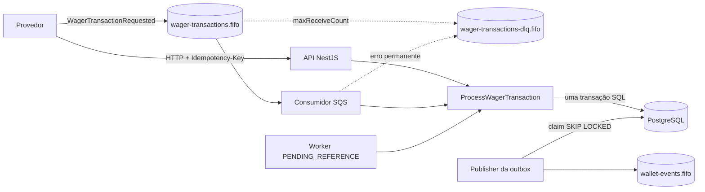
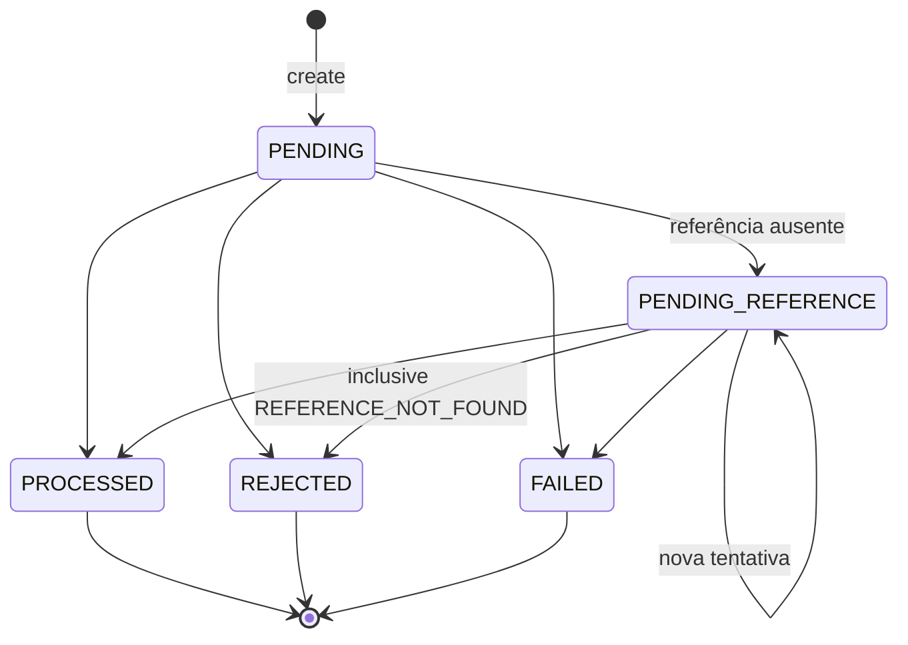

# Arquitetura

Este documento registra como a solução garante as invariantes do desafio, quais escolhas foram feitas onde o enunciado deixa a decisão para o candidato, e quais são os trade-offs e limitações conhecidos. As decisões mais difíceis de reverter também têm um ADR em [docs/adr/](docs/adr/). A linguagem do domínio está em [GLOSSARY.md](GLOSSARY.md).

## Sumário

1. [Visão geral](#visão-geral)
2. [Camadas](#camadas)
3. [Modelo de domínio](#modelo-de-domínio)
4. [Regras de negócio e interpretações](#regras-de-negócio-e-interpretações)
5. [Idempotência](#idempotência)
6. [Concorrência](#concorrência)
7. [Persistência e garantias no banco](#persistência-e-garantias-no-banco)
8. [Mensageria: consumidor SQS](#mensageria-consumidor-sqs)
9. [Transactional Outbox](#transactional-outbox)
10. [Referências fora de ordem](#referências-fora-de-ordem)
11. [API HTTP](#api-http)
12. [Observabilidade](#observabilidade)
13. [Autenticação](#autenticação)
14. [Estratégia de testes](#estratégia-de-testes)
15. [Trade-offs e limitações](#trade-offs-e-limitações)

## Visão geral

Toda instância roda os quatro papéis (API, consumidor, publisher e worker), cada um desligável por variável de ambiente. "N instâncias" significa N cópias completas competindo pelo mesmo banco e pelas mesmas filas, o caso mais exigente. A entrada HTTP e a entrada pela fila usam **o mesmo use case**.

Para uma operação, o use case grava numa única transação SQL: a Wager Transaction, o saldo da wallet, o Ledger Entry, as Outbox Messages e, se veio da fila, a Inbox Message. Ou tudo é confirmado junto, ou nada é (§6.5, §11).

## Camadas

| Camada | Conteúdo | Depende de |
|---|---|---|
| `domain/` | `Money`, `Wallet`, `WalletLedgerEntry`, `WagerTransaction`, `settleWagerTransaction`, eventos, Inbox e Outbox | só `decimal.js` |
| `application/` | use cases, portas (`WageringStore`, `TransactionRunner`, `WageringQueries`, `OutboxRepository`, `EventPublisher`, `WageringMetrics`, `StructuredLogger`, `Clock`, `IdGenerator`) e contratos de entrada (zod) | `domain/` |
| `infrastructure/` | MikroORM, SQS, workers, Prometheus, pino | portas da aplicação |
| `interfaces/http/` | controllers, validação, mapeamento de erros | `application/` |

O domínio não importa NestJS nem MikroORM. Os use cases também são classes puras, montadas por factories no [wagering.module.ts](src/wagering.module.ts). Assim os testes instanciam a mesma lógica sem subir o framework.

O módulo mais profundo é [`settleWagerTransaction`](src/domain/wagering/wager-settlement.ts). Ele é o único lugar que decide o efeito financeiro de uma operação: o use case carrega o estado, chama essa função e persiste o resultado.

## Modelo de domínio

Todas as classes têm construtor `private` e factories estáticas (`create`, `from`, `open`, `rehydrate`). O `rehydrate` reconstrói o estado persistido sem revalidar transições (§6.0).

### Money

- Valor `decimal.js` com escala fixa de 2. É imutável: toda operação devolve uma nova instância.
- **A entrada nunca é arredondada.** O `Money.from` aceita só strings no formato `^\d+(\.\d{1,2})?$`, e rejeita `NaN`, `Infinity`, notação científica, sinais, espaços, vírgula, string vazia, mais de 2 casas e números JSON. Como todas as operações internas são entre valores de 2 casas, elas são exatas.
- Valores negativos só existem como resultado interno (`subtract`, `negate`), nunca num contrato de entrada.
- Operação entre moedas diferentes lança `CurrencyMismatchError`. O modelo é multi-moeda (a wallet é única por player + moeda), e os testes cobrem o conflito BRL × USD.
- **Persistência:** `NUMERIC(20,2)` + `CHAR(3)`. O MikroORM mapeia `decimal` em modo string, então o valor sai do banco como `"0.30"` e entra direto em `Money.from`, sem nunca passar por `number`.

### Wallet

- `Wallet.open` cria a wallet já com o saldo inicial e `version = 1`, como no contrato do §9. Com saldo positivo, gera junto o lançamento `CREDIT` de abertura, partindo de `0.00`, para o ledger reconstruir o saldo exatamente.
- `debit` e `credit` alteram o saldo **e** devolvem o `WalletLedgerEntry` correspondente. Não existe caminho que altere um sem o outro.
- `version` só incrementa quando o saldo muda. Movimentos com valor zero são recusados justamente para isso.

### WagerTransaction e transições

Tentar transicionar a partir de um estado terminal lança `InvalidTransactionStateError`, tratado como erro de programação. A transação também guarda o **saldo observado** quando terminou (`resultingBalance`), que é o que o replay devolve (§7, regra 7), inclusive para `LOSS` e `REJECTED`, que não geram lançamento.

`OPENING` só nasce por `WagerTransaction.createOpening`. O `create` recusa esse kind com `INTERNAL_KIND_NOT_ALLOWED`.

### WalletLedgerEntry

Só tem campos `readonly` e um único método, `isBalanced()`. O `create` valida `balanceBefore ± money = balanceAfter`, valor positivo e saldo final não negativo. As mesmas regras existem no banco como `CHECK`.

### Eventos de integração

`IntegrationEvent<T>` é abstrata, e cada evento é uma subclasse com `eventType` e `version` definidos no próprio tipo: `WagerTransactionProcessed`, `WagerTransactionRejected`, `WalletBalanceChanged` e `WagerTransactionPendingReference`. O `data` carrega `MoneyProps` (string decimal), nunca uma instância de `Money`, e o envelope é congelado.

| Evento | `aggregateId` | Quando |
|---|---|---|
| `WagerTransactionProcessed` | id da transação | qualquer transação aplicada, inclusive `LOSS` e `OPENING` |
| `WagerTransactionRejected` | id da transação | rejeição por regra de negócio |
| `WalletBalanceChanged` | id da wallet | **somente** quando há lançamento (saldo mudou) |
| `WagerTransactionPendingReference` | id da transação | primeira vez em que a referência está ausente |

## Regras de negócio e interpretações

As regras do §7 estão em `settleWagerTransaction`, com um teste de unidade e um de integração para cada uma.

| Operação | Saldo | Ledger | Pode referenciar |
|---|---|---|---|
| `BET` | débito | 1 `DEBIT` | — |
| `WIN` | crédito | 1 `CREDIT` | `BET` da rodada (opcional) |
| `LOSS` | nenhum | nenhum | `BET` da rodada (opcional) |
| `REFUND` | crédito | 1 `CREDIT` | `BET` (obrigatório) |
| `ROLLBACK` | inverso da referência | 1 entrada invertida | `BET`, `WIN` ou `REFUND` (obrigatório) |

A referência é resolvida por `(providerId, referenceExternalTransactionId)` e precisa ter o mesmo provider, player, wallet, moeda e rodada. Reversões são sempre integrais e únicas por kind.

**Interpretações adicionais** (o §7 pede que sejam documentadas):

1. **`WALLET_PLAYER_MISMATCH`:** se o `playerId` do payload não é o dono da `walletId`, a transação é rejeitada. O enunciado não cita o caso, mas aceitar seria movimentar a wallet de outro jogador.
2. **`LOSS` aceita valor `0.00`**, porque registra o resultado sem mover saldo. Os outros kinds exigem valor maior que zero.
3. **`WIN` e `LOSS` podem referenciar a `BET` da rodada**, e a referência é validada como as demais. `BET` não referencia nada.
4. **Referência que existe mas ainda não é terminal** (`PENDING` ou `PENDING_REFERENCE`): a transação também espera. Referência `REJECTED` ou `FAILED` gera `REFERENCE_NOT_PROCESSED`.
5. **Reversão que deixaria o saldo negativo** é rejeitada com `REVERSAL_WOULD_OVERDRAW`, diferente de `INSUFFICIENT_FUNDS`, porque são situações operacionais diferentes (§7, regra 9).
6. **Payload inválido e wallet inexistente não são persistidos.** O provedor recebe o erro na hora (HTTP 400/404, ou DLQ na fila). Só violações de regra de negócio viram uma transação `REJECTED` auditável.
7. **A criação de wallet com saldo também publica eventos:** `WagerTransactionProcessed` (da `OPENING`) e `WalletBalanceChanged`.

### Taxonomia de `failureCode` (§7.2)

Cada código vem com a ação esperada do provedor ([failure-code.ts](src/domain/wagering/failure-code.ts)): **reenviar**, **corrigir** o payload (com nova Idempotency Key) ou **desistir**.

| Código | Quando | Ação |
|---|---|---|
| `INVALID_PAYLOAD` | estrutura, dinheiro ou kind inválidos; referência obrigatória ausente | corrigir |
| `INTERNAL_KIND_NOT_ALLOWED` | `OPENING` enviado por provedor | corrigir |
| `WALLET_NOT_FOUND` | wallet inexistente | corrigir |
| `WALLET_PLAYER_MISMATCH` | player do payload não é o dono da wallet | corrigir |
| `CURRENCY_MISMATCH` | moeda da operação ≠ moeda da wallet | corrigir |
| `INSUFFICIENT_FUNDS` | aposta acima do saldo | desistir |
| `REVERSAL_WOULD_OVERDRAW` | reversão deixaria saldo negativo | desistir |
| `REFERENCE_NOT_FOUND` | referência não chegou dentro do limite de espera | desistir |
| `REFERENCE_MISMATCH` | referência de outro provider, player, wallet, moeda ou rodada | corrigir |
| `REFERENCE_KIND_NOT_ALLOWED` | kind da referência não permitido para a operação | corrigir |
| `REFERENCE_NOT_PROCESSED` | referência terminou `REJECTED` ou `FAILED` | desistir |
| `ALREADY_REVERSED` | referência já revertida por esse kind | desistir |
| `AMOUNT_MISMATCH` | reversão com valor diferente da referência | corrigir |
| `IDEMPOTENCY_CONFLICT` | mesma key com payload diferente, ou mesma operação com outra key | corrigir |

## Idempotência

- **Fonte da verdade:** o header `Idempotency-Key` (na fila, o campo `idempotencyKey`), gravado com `UNIQUE` no banco. Não existe cache em memória. A operação do provedor `(providerId, externalTransactionId)` também é `UNIQUE`.
- **`payloadHash`:** SHA-256 (hex) do **JSON canônico** dos campos de negócio, com chaves ordenadas recursivamente e sem espaços: `providerId`, `externalTransactionId`, `playerId`, `walletId`, `roundId`, `gameId`, `kind`, `money` e `referenceExternalTransactionId` (`null` se ausente). O `amount` entra normalizado pelo `Money`, então `"25"` e `"25.00"` são o mesmo payload. Header, `messageId` e outros metadados de transporte ficam de fora ([payload-hash.ts](src/application/wagering/payload-hash.ts)).
- **Replay:** mesma key e mesmo hash devolvem o resultado original (status, `failureCode` e saldo observado) com `idempotentReplay: true` e o mesmo status HTTP. Um `REJECTED` continua `REJECTED` mesmo que depois entre dinheiro.
- **Conflito:** mesma key com hash diferente, ou mesma operação do provedor sob outra key, gera `IDEMPOTENCY_CONFLICT` (HTTP 409). Nunca é tratado como replay.
- **Inbox:** na fila, `(consumerName, messageId)` é a chave primária de `inbox_messages`, gravada na mesma transação da operação. Uma redelivery encontra a Inbox e devolve o resultado original sem novo efeito.

## Concorrência

**Estratégia:** lock pessimista por wallet ([ADR-0002](docs/adr/0002-pessimistic-lock-per-wallet.md)). O fluxo de uma operação nova, dentro de uma transação SQL:

1. Inbox já processada → replay.
2. Busca pela Idempotency Key → replay ou conflito, sem pegar lock (caminho rápido).
3. `SELECT … FOR UPDATE` **só na linha da wallet**. Wallets diferentes nunca se bloqueiam, e não existe lock global.
4. **Nova busca pela key, já com o lock.** Uma duplicata concorrente que acabou de commitar aparece aqui e vira replay, em vez de tentar gravar de novo.
5. Resolve a referência, aplica `settleWagerTransaction` e grava. O `UPDATE` da wallet é condicionado à versão lida (`WHERE version = ?`), uma defesa extra caso alguém escreva sem o lock.

Corridas que o banco resolve viram erros das portas (`DuplicateWriteError` para unique violation, `ConcurrencyConflictError` para a versão desatualizada) e a operação é repetida até 3 vezes; a nova tentativa vira replay. Se ainda assim falhar, a API responde 503 (transitório) e a fila faz retry.

**Por que não lock otimista:** numa wallet muito disputada, o cenário que o §8 testa, ele gera muitos conflitos e retries esgotados. **Por que não só `UPDATE … WHERE balance >= x`:** resolve o débito, mas não dá uma leitura consistente da referência, da idempotência e do `balanceBefore`/`balanceAfter` do ledger na mesma decisão.

A ordenação e a deduplicação do SQS FIFO são **otimizações**: os testes multi-instância enviam de propósito cada mensagem em um grupo FIFO diferente, para que as instâncias disputem a mesma wallet, e as invariantes se mantêm.

## Persistência e garantias no banco

**ORM:** MikroORM com `EntitySchema` sobre classes de registro de persistência, e mappers que convertem para o domínio via `rehydrate` ([ADR-0001](docs/adr/0001-mikro-orm-with-entity-schema.md)).

**Estratégia transacional:** cada operação usa `em.fork().transactional()`. Dentro dela, as escritas são `em.insert`/`nativeUpdate` explícitos, em vez de `persist` + `flush`. Isso deixa a ordem dos comandos determinística (wallet → transação → ledger → outbox), respeitando as chaves estrangeiras compostas, e permite o `UPDATE` condicionado à versão. As leituras usam o `EntityManager` com `LockMode.PESSIMISTIC_WRITE` quando precisam de lock.

**Migrations:** escritas à mão, versionadas e reversíveis (`up`/`down`). Um teste faz up → down → up, e o helper de teste recria o schema por esse mesmo caminho a cada teste.

Garantias aplicadas **no schema** (§5.9), cada uma com um teste que tenta violá-la via SQL:

| Garantia | Mecanismo |
|---|---|
| Saldo nunca negativo | `CHECK (balance_amount >= 0)`, `CHECK (balance_after >= 0)` |
| No máximo uma wallet por player + moeda | `UNIQUE (player_id, currency)` |
| Idempotência persistente | `UNIQUE (idempotency_key)`, `UNIQUE (provider_id, external_transaction_id)`, PK `(consumer_name, message_id)` na inbox |
| Reversão única por kind | índice único parcial `(reference_transaction_id, kind) WHERE kind IN ('REFUND','ROLLBACK') AND status = 'PROCESSED'` |
| No máximo um lançamento por transação | `UNIQUE (transaction_id)` em `wallet_ledger_entries` |
| Lançamento aritmeticamente correto | `CHECK` de `balance_before ± amount = balance_after` conforme `direction` |
| Lançamento na moeda da wallet e ligado à transação certa | FKs compostas `(wallet_id, currency)` e `(transaction_id, wallet_id)` |
| Ledger imutável | triggers que recusam `UPDATE`, `DELETE` e `TRUNCATE` |
| Consistência de estados | `CHECK` de kinds e status, referência obrigatória para `REFUND`/`ROLLBACK`, `failure_code` obrigatório em `REJECTED`/`FAILED` |

## Mensageria: consumidor SQS

[sqs-wager-consumer.ts](src/infrastructure/sqs/sqs-wager-consumer.ts), consumindo `wager-transactions.fifo`:

- **Ack só depois do commit.** O `DeleteMessage` só acontece depois que o use case devolveu, ou seja, depois do commit.
- **Classificação de erros (§10):**
  - **Negócio** (ex.: `INSUFFICIENT_FUNDS`): a transação já é `REJECTED` no banco, então é terminal e recebe ack.
  - **Permanente** (JSON inválido, tipo desconhecido, payload inválido, `OPENING`, wallet inexistente, conflito de idempotência): a cópia vai para a DLQ com o atributo `failureReason`, e **só depois** a mensagem é confirmada, para nada se perder se o processo cair no meio.
  - **Transitório ou inesperado:** sem ack. A visibilidade é ajustada com `ChangeMessageVisibility` em backoff exponencial (2s, 4s, 8s…, até 300s). Esgotado o `maxReceiveCount = 5` da fila, o redrive do SQS move a mensagem para a DLQ.
- O lote é processado sequencialmente, preservando a ordem do grupo FIFO.
- **`SIGTERM`:** para de receber, conclui a mensagem em andamento e devolve com visibilidade 0 as que ainda não começaram, com prazo máximo de `SHUTDOWN_TIMEOUT_MS`. Testado também no Docker (`docker compose stop`): o processo sai com código 0 em menos de 1s.
- **Worker morto depois do commit e antes do ack:** a mensagem reaparece quando a visibilidade expira, e a Inbox transforma a reentrega em replay.

## Transactional Outbox

O evento é gravado na mesma transação da mudança financeira, e um worker em cada instância publica depois do commit ([outbox-publisher.ts](src/application/outbox/outbox-publisher.ts)):

1. **Reserva por lease.** Um único comando reserva até 50 eventos vencidos e marca `next_attempt_at = now + 30s`: `UPDATE … WHERE id IN (SELECT … FOR UPDATE SKIP LOCKED) RETURNING *`. Publishers concorrentes nunca pegam o mesmo evento, e **nenhuma transação fica aberta durante a chamada de rede ao SQS**.
2. **Publica** em `wallet-events.fifo`, com `MessageGroupId = aggregateId` e `MessageDeduplicationId = eventId`.
3. **Marca `published_at` só depois de o SQS aceitar.** Em falha, a próxima tentativa é agendada com backoff de 1s a 60s.

Se a instância morre depois do commit e antes de publicar, os eventos continuam pendentes e outra instância publica. Se morre depois de reservar, a lease expira e outra instância assume. Se morre depois de publicar e antes de marcar, o evento é publicado de novo. **A entrega é at-least-once**: o consumidor deduplica pelo `eventId` do envelope, e a deduplicação do FIFO é só otimização.

O destino `wallet-events.fifo` é uma interpretação, já que o enunciado não define para onde publicar ([ADR-0004](docs/adr/0004-integration-events-to-sqs-fifo-queue.md)).

## Referências fora de ordem

[pending-reference-processor.ts](src/application/wagering/pending-reference-processor.ts) (§7.1):

- A transação guarda as tentativas e a próxima tentativa (`next_reference_attempt_at`).
- **Backoff exponencial:** 2s, 4s, 8s…, com teto de 5 min.
- **Limite de 10 tentativas**, cerca de 18,5 minutos no total. Isso cobre atrasos normais de entrega sem deixar uma operação financeira pendente por horas. Esgotado o limite, a transação vira `REJECTED` com `REFERENCE_NOT_FOUND` e publica `WagerTransactionRejected`.
- O worker reserva as transações vencidas com `SKIP LOCKED` e uma lease de 30s, e reprocessa cada uma pelo mesmo caminho do fluxo principal: lock da wallet, nova leitura e `settleWagerTransaction`.
- O evento `WagerTransactionPendingReference` sai só na primeira vez.

## API HTTP

O mapeamento é o mesmo em todos os endpoints ([http-exception.filter.ts](src/interfaces/http/http-exception.filter.ts)). Os resultados de negócio saem do controller; os erros saem do filtro, sempre no formato `{ failureCode, message, correlationId }`.

| Situação | Status | Código |
|---|---|---|
| Transação processada (inclusive replay) | 200 | — |
| Wallet criada | 201 | — |
| Aceite com referência pendente | 202 | — |
| Payload inválido, JSON malformado, sem `Idempotency-Key` | 400 | `INVALID_PAYLOAD`, `INTERNAL_KIND_NOT_ALLOWED` |
| Wallet, transação ou rota inexistente | 404 | `WALLET_NOT_FOUND`, `TRANSACTION_NOT_FOUND`, `NOT_FOUND` |
| Conflito de idempotência ou wallet duplicada | 409 | `IDEMPOTENCY_CONFLICT`, `WALLET_ALREADY_EXISTS` |
| Rejeição por regra de negócio (replay mantém o 422) | 422 | `failureCode` da regra |
| Falha transitória (banco/fila fora, corrida que esgotou as tentativas) | 503 + `Retry-After: 1` | `TRANSIENT_FAILURE` |
| Erro inesperado | 500 | `INTERNAL_ERROR` |

Os códigos `WALLET_ALREADY_EXISTS`, `TRANSACTION_NOT_FOUND`, `NOT_FOUND`, `TRANSIENT_FAILURE` e `INTERNAL_ERROR` são da camada HTTP (`ApiErrorCode`) e não fazem parte da taxonomia de transação. Eles existem para que todo erro tenha um código legível por máquina. Com essa separação, o provedor decide pelo status se pode reenviar (503), se precisa corrigir (400/409) ou se o resultado é definitivo (422), sem interpretar mensagens.

O cursor do ledger é opaco (base64url de `(createdAt, id)`) e usa keyset em vez de `OFFSET`. Por isso continua estável quando entram lançamentos novos entre as páginas.

**Reconciliação:** soma créditos e débitos do ledger sob um lock compartilhado (`FOR SHARE`) da wallet e compara com o saldo armazenado. Divergência **nunca é corrigida**: é logada, contada em `wagering_reconciliation_divergences_total` e sinalizada com `consistent: false`.

## Observabilidade

- **Logs JSON** (pino) com `correlationId`, `messageId`, `transactionId`, `walletId` e `providerId`, mais kind, status e `failureCode`. Não registram corpo de requisição, headers nem payload financeiro. A redaction censura `money`, `balance`, `payload`, `data` e `body` como segunda linha de defesa. O `correlationId` vem do header `X-Correlation-Id` (ou é gerado) e volta na resposta; na fila, é o `messageId` do envelope.
- **Métricas** em `GET /metrics` (Prometheus):

  | Métrica | Requisito (§12) |
  |---|---|
  | `wagering_transactions_total{status,kind,source}` | transações por status |
  | `wagering_duplicates_detected_total{kind}` | duplicatas (replay, redelivery da inbox, conflito) |
  | `wagering_retries_total{operation}` | retries |
  | `wagering_messages_dead_lettered_total{reason}` | mensagens em DLQ |
  | `wagering_lock_conflicts_total`, `wagering_wallet_lock_wait_seconds` | conflitos de lock e espera pelo lock da wallet |
  | `wagering_outbox_publish_lag_seconds`, `wagering_outbox_pending_messages`, `wagering_outbox_oldest_pending_age_seconds` | outbox lag |
  | `wagering_processing_duration_seconds{source}` | latência de processamento |
  | `wagering_reconciliation_divergences_total` | divergências de reconciliação (§9) |

  As métricas de backlog da Outbox são lidas do banco a cada coleta, então mostram atraso mesmo que nenhum publisher esteja rodando.
- **Health:** `/health/live` não consulta dependências, para o orquestrador não reiniciar o processo por falha externa. `/health/ready` testa PostgreSQL e SQS com timeout de 2s e responde 503 indicando qual está fora. Nenhum dos dois exige autenticação.

## Autenticação

Não implementada, como o §2 permite ([ADR-0003](docs/adr/0003-authentication-not-implemented.md)). O ponto de extensão é o [`AuthGuard`](src/interfaces/http/auth/auth.guard.ts), um guard no-op aplicado aos controllers de negócio; health e métricas ficam fora dele.

O desenho que seria adotado: Keycloak no Docker Compose, um client (client credentials) por provedor, validação do JWT no guard e comparação da claim do provedor com o `providerId` do payload. Mensagens da fila são tratadas como canal interno confiável, mas a identidade contida nelas passa pelas mesmas validações de domínio.

## Estratégia de testes

| Nível | O que cobre |
|---|---|
| **Unidade** (sem I/O) | `Money` (escala, entradas inválidas, conflito de moeda), invariantes da `Wallet`, transições da `WagerTransaction`, todas as regras do §7 em `settleWagerTransaction`, hash canônico, eventos, Outbox e Inbox, mapeamento HTTP, redaction de logs |
| **Integração** (PostgreSQL e LocalStack reais) | constraints e migrations, atomicidade (falha injetada depois do ledger desfaz tudo), Inbox e redelivery, retry, DLQ explícita e por redrive, crash depois do commit, `SIGTERM`, publishers concorrentes, recuperação por lease, `PENDING_REFERENCE`, API HTTP de ponta a ponta, readiness e métricas |
| **Concorrência** (paralelismo real) | 50 cópias da mesma aposta, cenário 100/80/80, 200 apostas numa wallet disputada, wallets distintas sem bloqueio mútuo, reversões concorrentes, **3 processos reais** da aplicação com HTTP e SQS duplicados, `SIGKILL` no meio da carga e reinício completo |

A lease da Outbox e a espera por referência usam um `Clock` injetado, em vez de dormir. Os testes de fila dependem do tempo real de visibilidade do SQS, com backoff reduzido para 1–2s. Os cenários que movimentam saldo terminam verificando a invariante `wallet.balance == saldo reconstruído pelo ledger`. A suíte completa foi executada duas vezes seguidas sem falhas, para checar o determinismo.

## Trade-offs e limitações

- **Vazão de uma wallet muito disputada.** O lock pessimista serializa as operações de uma mesma wallet, então a vazão por wallet é limitada pela duração da transação, que é curta e sem chamadas de rede. Não há `lock_timeout` configurado: com o banco degradado, as requisições esperam o lock em vez de falhar rápido.
- **Retenção.** Mensagens publicadas da Outbox e registros da Inbox não são expurgados. Em produção, seria preciso um job de limpeza com um prazo de retenção maior que a janela de redelivery.
- **Rejeições de validação não ficam no banco.** Payload inválido e wallet inexistente não são persistidos (interpretação 6). Eles ficam visíveis em logs, métricas e, na fila, na DLQ, mas não como transação auditável.
- **Pendência de referência e falhas de infraestrutura.** Uma transação `PENDING_REFERENCE` cujo reprocessamento falha por motivo de infraestrutura volta pela lease sem consumir tentativa. O limite de 10 conta só as vezes em que a referência de fato não foi encontrada.
- **Consumidores dos eventos.** Como a entrega é at-least-once, quem consome `wallet-events.fifo` precisa deduplicar pelo `eventId`.
- **Reconciliação.** É sob demanda e por wallet; não há uma varredura agendada de todas as wallets.
- **Ledger de entrada simples.** O ledger de partidas dobradas, que o enunciado marca como diferencial opcional, não foi implementado.
- **Configuração para AWS real.** O `SQS_ENDPOINT` tem LocalStack como padrão. Para AWS real, a configuração precisaria aceitar endpoint ausente e credenciais via IAM.
- **`/metrics` aberto.** Assim como os health checks, o endpoint não tem autenticação; em produção ficaria restrito à rede interna.
- **Teste de carga** (`bun run test:load`), diferencial opcional, não foi implementado.
